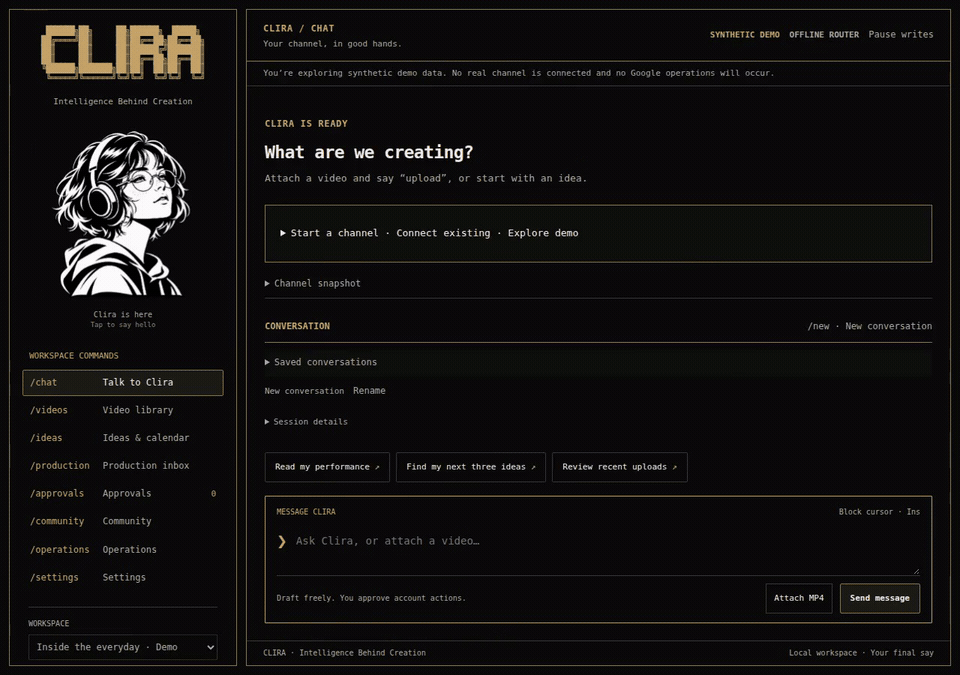

<p align="center">
  
</p>

<h1 align="center">Clira</h1>

<p align="center"><strong>Intelligence Behind Creation</strong></p>

<p align="center">
  Your YouTube channel. One creative workspace.<br>
  Plan the video, prepare its package, review the result, and approve the upload—in one conversation.
</p>

<p align="center">
  <a href="#get-started">Get started</a> ·
  <a href="#give-clira-a-video">Upload workflow</a> ·
  <a href="#a-character-with-personality">Meet Clira</a> ·
  <a href="#documentation">Documentation</a>
</p>

**Clira is a local AI workspace for YouTube creators.** It brings channel research, ideas, script
briefs, titles, descriptions, publishing preparation, analytics and approved account actions into
one place. Your conversations, creator preferences and channel context stay connected as you work.

Its everyday interface is a web app with a terminal-inspired design: antique-gold frames, readable
monospace text, a block cursor, and an expressive monochrome character. All eight workspace views
remain available through the command navigation. You can select and copy replies normally.

**Current development version: `1.0.0rc1`.** Install the current code from `main` using the steps below.
This is a release candidate, not a published stable v1.0.0 release.

## See the current workspace

<p align="center">
  
</p>

*Actual browser recording with synthetic demo data. [Open the current screenshot](docs/media/web/terminal-workspace.png).*

## Give Clira a video

1. **Attach a finished MP4** and tell Clira: “Upload this video.”
2. **Clira prepares the package:** file checks, a title, description, tags and a suggested outline.
3. **Review in chat:** watch the video, edit the package, and complete rights/disclosure choices.
4. **Approve & upload privately** when the exact preview is ready.
5. **Get the receipt and link** after Clira runs and verifies the approved upload.

The preview and approval live inside the chat. You do not have to copy the same title and description
between separate forms. Clira uses the selected channel, preserves the approved video bytes and
package, and records the resulting job so you can inspect what happened.

With Gemini enabled, Clira analyzes **three sampled frames** to draft the package. It does not listen
to the audio or analyze every moment of the video. The suggested script outline is an editorial draft,
not a transcript. Offline demo mode uses clearly labeled templates instead.

Uploads start **private**. Making a video public, scheduling publication, changing existing metadata,
posting a comment, or uploading a thumbnail/caption file requires its own approval.

[Connect a channel and enable uploads →](docs/CHAT_UPLOAD.md)

## What Clira helps with

| Work | What you can do |
| --- | --- |
| Plan | Develop a channel direction, brainstorm ideas, save script briefs and organize a calendar. |
| Prepare | Draft titles, descriptions and tags; import a finished MP4; inspect local media checks. |
| Review | Preview the video and its editable package, check disclosures, and approve the exact account action. |
| Understand | Inspect connected-channel uploads and dated analytics, with visible sources and unavailable-data states. |
| Operate | Track durable jobs, approvals, receipts and recovery from the same workspace. |
| Continue | Resume saved conversations and reuse the creator preferences and notes you chose to save. |

The sidebar includes **Chat, Video library, Ideas & calendar, Production inbox, Approvals, Community,
Operations and Settings**. The browser is the main workspace; the CLI remains available for scripts
and terminal use.

## A character with personality

<p align="center">
  
</p>

Clira keeps her messy short hair, round glasses, headphones and hoodie. Her reactions are restrained:

- **Hover:** a curious look and a small head tilt.
- **Single click:** a little smile. **Double click:** quiet delight.
- **Circle the pointer:** a brief dizzy reaction.
- **While you work:** attention during typing, thinking during requests, and distinct preview/review/error states.

Natural blinks and tiny gaze movements make her feel present. Touch and keyboard interactions work
too. Settings offers **Full, Reduced and Off** motion; the app respects the operating system's
reduced-motion preference. The terminal retains its Braille portrait.

The character GIF uses the shipped controller with real pointer inputs and local presentation-event
examples. It does not show an account upload. [Static portrait](docs/media/character/character-poster.png)
· [Interaction details](docs/LIVE_CHARACTER.md) · [Black-background logo](clira/web/assets/clira-logo-black.png).

## Get started

You need **Python 3.12+**, [uv](https://docs.astral.sh/uv/), and **ffmpeg/ffprobe** for video validation.

```bash
git clone https://github.com/Gurtejhundal/Clira.git
cd Clira
uv sync --locked
./run.sh --mode demo serve
```

Open **[http://127.0.0.1:8765](http://127.0.0.1:8765)**. Demo mode needs no Google credentials and
uses synthetic channel data with a limited offline command router.

To use your own channel and AI provider:

1. Follow [Google/YouTube setup](docs/SETUP.md) for a Desktop OAuth client and the appropriate channel grant.
2. Configure Gemini using the private, masked connection flow described in [creator setup](docs/CREATOR_SETUP.md).
3. Start `./run.sh --mode live serve`. Follow the [chat-upload guide](docs/CHAT_UPLOAD.md) to enable approved uploads.

For personal creator setup in the terminal, run `uv run --locked clira`. You can review saved
preferences and consent before sharing relevant profile context with your configured AI provider.
The web app does not require the interactive terminal to stay open.

## Your channel, your approval

Clira runs one Python agent with typed tools. Account actions pass through deterministic channel,
permission and approval checks. The character has no account authority.

- Local conversations, preferences and jobs live in SQLite; credentials are kept in separate owner-only files.
- Account writes need the correct grant, explicit write enablement and approval of the exact request.
- Uploaded media and approved payloads are bound to their channel and content hashes.
- Interrupted or uncertain account operations stop for inspection instead of blindly starting duplicates.

Local storage does not make every provider interaction offline: enabled Gemini requests send relevant
context and sampled video frames to the configured provider; YouTube operations contact Google.

## Current scope

Clira accepts **finished videos up to 256 MiB** in chat. It prepares and manages their release workflow;
it does not autonomously film, edit or render them. Audio transcription, complete-video understanding,
automatic image-model thumbnails and hosted/team access are not implemented. Thumbnail/caption
packaging has separate local and approved-upload paths.

An owner-authorized authenticated read and private demo upload are recorded in the verification notes.
The newer chat-upload automation has isolated simulation coverage; its live content quality and
thumbnail/caption playback remain separate validation work. No growth or revenue outcome is guaranteed.

[Detailed verification and limits →](docs/VERIFICATION.md)

## Documentation

| Guide | Contents |
| --- | --- |
| [Channel setup](docs/SETUP.md) | Google OAuth, API prerequisites and grants |
| [Upload from chat](docs/CHAT_UPLOAD.md) | Video preparation, exact review and recovery |
| [Web workspace](docs/WEB_WORKSPACE.md) | Navigation, keyboard controls, text selection and themes |
| [Creator setup & memory](docs/CREATOR_SETUP.md) | Preferences, saved notes, consent and optional Telegram |
| [Packaging](docs/PACKAGING.md) | MP4, metadata, thumbnails and timed captions |
| [Character system](docs/LIVE_CHARACTER.md) | Expressions, motion settings and local event hooks |
| [Architecture](docs/PRODUCT_ANALYSIS.md) | Agent, tools, state and account boundaries |
| [Changelog](CHANGELOG.md) | Changes in the current codebase |

## Development

```bash
uv sync --locked --extra dev
uv run --locked pytest -q
uv run --locked ruff check clira tests scripts
node --check clira/web/app.js
uv run --locked playwright install chromium
uv run --locked python tests/browser_smoke.py --output /tmp/clira-browser-check
```

Browser checks run against isolated synthetic demo data. See the [verification record](docs/VERIFICATION.md)
and [media capture notes](docs/brand/LOGO_AND_README_MEDIA.md) for what was tested and how the previews were made.

<p align="center"><sub>The name Clira draws inspiration from Clio's storytelling and Minerva's strategic wisdom.</sub></p>
