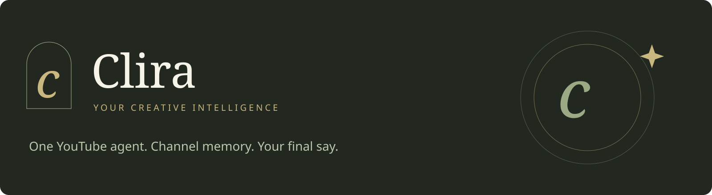
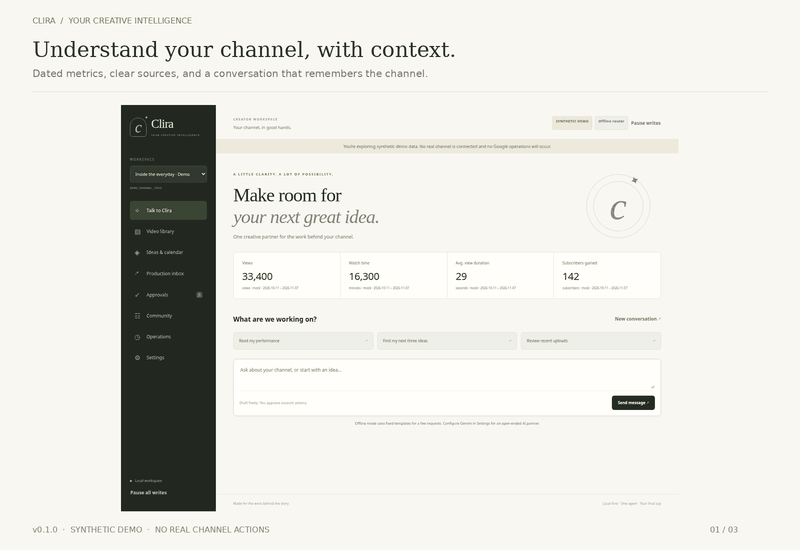
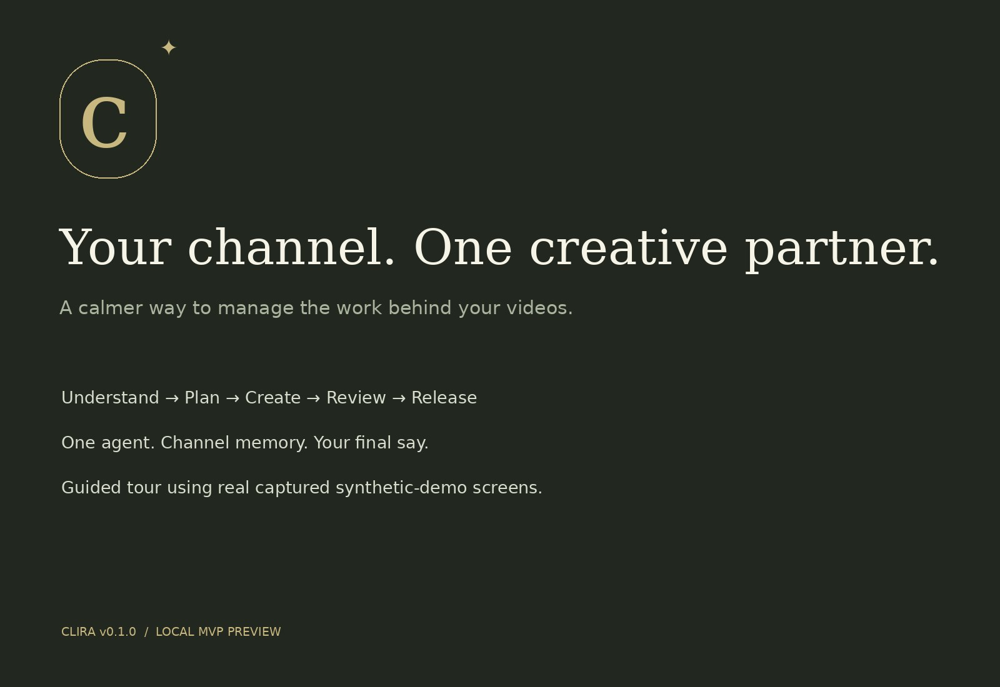
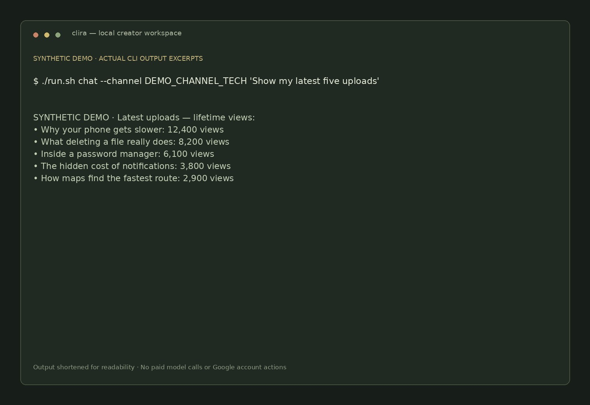

<p align="center">
  
</p>

<p align="center">
  <strong>Your channel. One creative partner.</strong><br>
  A local AI workspace for the work behind your YouTube videos.<br>
  Research, plan, write, review and manage approved account actions with one agent that remembers your channel.
</p>

<p align="center">
  <a href="https://github.com/Gurtejhundal/Clira/releases/tag/v0.1.0"></a>
  
  <a href="https://github.com/Gurtejhundal/Clira/actions/workflows/release.yml"></a>
  
</p>

<p align="center">
  <a href="#run">Get started</a> ·
  <a href="#see-clira-in-action">Watch the demos</a> ·
  <a href="docs/SETUP.md">Connect YouTube</a> ·
  <a href="https://github.com/Gurtejhundal/Clira/releases/tag/v0.1.0">Download v0.1.0</a> ·
  <a href="docs/PRODUCT_ANALYSIS.md">Product & architecture</a>
</p>

> **First public MVP preview.** Explore immediately with synthetic demo data and a limited offline
> command router. Real AI needs your configured Gemini account; real channel operations need Google
> OAuth and owner approval. Live-channel reads and mutations remain unverified. Rendering stays external.

## See Clira in action

<p align="center">
  
</p>

| Guided product tour · 39 seconds | CLI walkthrough · 24 seconds |
|:---:|:---:|
| [](https://github.com/Gurtejhundal/Clira/releases/download/v0.1.0/Clira-tour.mp4) | [](https://github.com/Gurtejhundal/Clira/releases/download/v0.1.0/Clira-cli.mp4) |
| [▶ Watch or download the captioned MP4](https://github.com/Gurtejhundal/Clira/releases/download/v0.1.0/Clira-tour.mp4) | [▶ Watch or download the captioned MP4](https://github.com/Gurtejhundal/Clira/releases/download/v0.1.0/Clira-cli.mp4) |

The product tour uses real captured **synthetic-demo screens** with a guided pan/scroll presentation.
The CLI walkthrough uses actual command-output excerpts. Both are silent with on-screen explanations.
[Transcript, original captures and media details →](docs/media/README.md)

## A creator workflow, held together

| You want to… | Clira keeps the work connected |
|---|---|
| Understand your channel | Recent uploads, dated metrics, reporting freshness and a weekly comparison |
| Find the next story | Public-video research, channel-specific ideas and duplicate-topic checks |
| Develop the package | Script briefs, source-review notes, titles, descriptions and editorial lint |
| Prepare a finished video | Manual production handoff, MP4 validation, managed copies and rights review |
| Put it on the right channel | Exact approval preview, private-first upload, saved session and verified receipt |
| Keep release and audience work moving | Separately approved publishing, metadata changes and comment replies |
| Know what happened | Channel memory, durable jobs, visible errors and an append-only action history |

**One Python agent, explicit tools and deterministic permissions.** Channel identity, content memory
and approvals stay isolated. No Hermes runtime, autonomous subagents or required renderer.

## Run

Requires Python 3.12+, [uv](https://docs.astral.sh/uv/), and ffmpeg/ffprobe for media validation.
From this directory:

```bash
./run.sh
```

Open [the local dashboard](http://127.0.0.1:8765/). The launcher installs the locked dependencies
into `.venv`. State, imported copies and owner-only secrets live in `.clira` (ignored by Git).
Use `CLIRA_DATA_DIR` for another state directory. The server binds only to loopback.

```bash
./run.sh doctor
./run.sh chat --channel DEMO_CHANNEL_TECH 'Show my latest five uploads'
./run.sh ideas --channel DEMO_CHANNEL_TECH
./run.sh tool weekly_digest --channel DEMO_CHANNEL_TECH
```

## What works

- One bounded model/tool loop; strict input and result schemas; Gemini REST adapter; daily model request cap.
- Isolated channel profiles, conversation history, ideas, scripts, metadata and editorial calendars.
- Google desktop OAuth with PKCE, exact channel-ID confirmation, refresh and local disconnect.
- Official channel/video reads, lifetime video statistics, dated analytics, two-week comparisons,
  public-video research and comment reads. Empty analytics are unavailable, never invented zeros.
- MP4 import with ffprobe QC, managed copies, hashing, rights evidence and human creative review.
- Private resumable uploads with persisted secret sessions, receipts, retry backoff and crash recovery.
- Exact, expiring, single-use approvals; separate approval and execution; idempotent jobs; append-only audit.
- Approved metadata updates, future public scheduling, publication and exact comment replies.
- Responsive eight-view dashboard and CLI; pause writes; database backup; optional disabled systemd templates.
- Optional installed title/hook editorial utilities. Scores are labeled heuristics, not outcome forecasts.
- Manual production handoff protocol. Lemo remains external and unmodified.

## Connect a real channel

Enable YouTube Data API v3 and YouTube Analytics API in your Google Cloud project. Configure
the consent screen/test users and create a **Desktop app** OAuth client. Keep the downloaded JSON
outside this repository. See [the Google setup guide](docs/SETUP.md).

```bash
export CLIRA_GOOGLE_CLIENT_FILE=/absolute/path/outside/repo/client.json
./run.sh --mode live connect
./run.sh --mode live channels
./run.sh --mode live chat --channel YOUR_ACTUAL_UC_ID 'Show my latest five uploads'
./run.sh --mode live serve
```

You sign in through Google in your browser and confirm the immutable channel ID in the terminal.
No credentials belong in chat. The initial grant is read-only plus basic analytics.

## Enable the AI model yourself

```bash
export CLIRA_MODEL=gemini
# Supply GEMINI_API_KEY privately using your shell or a secrets manager.
export CLIRA_ALLOW_MODEL_CALLS=1
export CLIRA_MAX_MODEL_CALLS_DAY=50
./run.sh --mode live serve
```

`CLIRA_MODEL_ID` defaults to `gemini-2.5-flash` and is configurable. The daily request cap counts
each generateContent request conservatively, including failed requests. Output is limited to
4,096 tokens per call and eight tool calls per turn. This is **not a currency budget**; use your
provider's billing controls as well. No paid model calls were made during development.

## Private upload

Reconnect with upload capability, then explicitly enable approved writes:

```bash
./run.sh --mode live connect --capability upload
export CLIRA_ENABLE_WRITES=1
./run.sh --mode live serve
```

In Production inbox, copy the finished MP4 into the displayed imports directory, enter its
metadata/disclosure choices, document rights for **all video and audio**, and confirm creative review.
Validate and prepare, review the exact PRIVATE request in Approvals, approve it, then execute it.
The receipt must contain a real video ID and `verified_remotely: true` before treating a live upload
as verified. Rendering and legal clearance are not established by technical QC.

For metadata/publication/replies reconnect with `--capability manage`. These always require their
own exact approval. Scheduling is deliberately limited to private videos originally uploaded and
tracked by Clira. YouTube also enforces its never-published requirement and project restrictions.

```bash
./run.sh approval show APPROVAL_ID --channel CHANNEL_ID
./run.sh approval approve APPROVAL_ID --channel CHANNEL_ID
./run.sh jobs run JOB_ID --channel CHANNEL_ID
./run.sh jobs list --channel CHANNEL_ID
./run.sh pause-all
```

## Recovery and backup

`clira worker` processes already approved due jobs once; no background timer is enabled for you.
`clira recover` checks expired leases. Resume interrupted uploads using the **same job**, never by
starting another upload. `RECOVERY_REQUIRED` means inspect YouTube and the receipt/session before
manual repair. The app deliberately refuses automatic replays of ambiguous comments or writes.

Expired resumable jobs can request fresh owner consent using `clira approval renew ID --channel ID`;
the job and saved session stay the same. Edited requests without an external-write checkpoint can
be prepared again with fresh consent. Completed uploads remain deduplicated by channel and file hash.

```bash
./run.sh backup /safe/location/clira-backup.sqlite3
./run.sh disconnect --channel CHANNEL_ID
```

A database backup excludes secrets and media copies. Back up `.clira/assets` separately; protect
credential backups separately. Disconnect removes local credentials; revoke the Google grant at
[Google account permissions](https://myaccount.google.com/permissions) if needed. Pausing or
disconnecting cannot undo an in-flight request or cancel a publication already scheduled on YouTube.

## Verify

```bash
uv run --extra dev pytest -q
uv run --extra dev ruff check clira tests
node --check clira/web/app.js
uv run --extra dev playwright install chromium
uv run --extra dev python tests/browser_smoke.py
```

If an existing browser is used, set `CLIRA_BROWSER=/absolute/path/to/chromium` for the browser test.
The browser test creates its own temporary demo database and never signs in or mutates a real channel.
See [verification evidence](docs/VERIFICATION.md) and [the product analysis](docs/PRODUCT_ANALYSIS.md).

## Limits and remaining work

The live-channel MVP gate is **not yet verified**. No OAuth client or Gemini key was configured in
the inspected environment. Thumbnail uploads, retention/cohort diagnostics, external-renderer
execution, automatic fact verification and hosted/team access are not implemented. Script evidence
links remain unverified; public search results are examples, not trend proof. Semantic duplicate
detection currently uses normalized title similarity, not embeddings. UI reads are capped to recent
items; complete-history pagination is a future improvement. Nothing in this release guarantees
growth, licensing clearance, or replacement of human creative judgment.

The original 21-file build pack is preserved under `mds/Clira_Agent_Architecture_Build_Pack/Clira/`.
