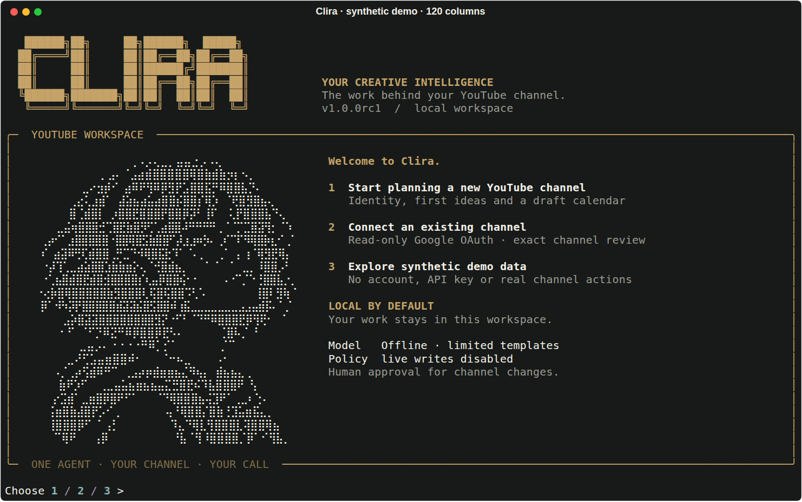

# Terminal visual pass · 10 November 2026

The previous startup printed the portrait, a mistakenly included specification footer, and plain
onboarding text vertically. The terminal now uses an original Clira wordmark, an aligned two-column
portrait/workspace frame, restrained gold accents, clear onboarding choices and readable conversation
sections. The approved 22-line portrait itself is unchanged. The reference informed hierarchy and
spacing; no Hermes assets, runtime or code were reused.



[Connected workspace composition with synthetic demo data](media/terminal/workspace-120.png).
These PNGs are generated from the real Rich renderer using system monospace fonts. They are render
previews, not screenshots of a native terminal window. Real pseudo-terminals are exercised separately.

## Behavior

| Terminal | Layout |
|---|---|
| 100+ columns, 36+ rows | Wordmark, approved monochrome portrait and status/onboarding side by side |
| 80–99 columns | Wordmark and readable single-column frame; no portrait |
| 52–79 columns | Stacked wordmark/tagline and single-column frame |
| Under 52 columns | Simple text, full labels and prompt; no large art or frame |
| Short windows | Compact title and onboarding; no portrait |
| `--no-logo` | Small text title; no large wordmark or portrait |

Output is bounded to 124 columns for readable line lengths, and reflows after terminal resizing.
Auto uses the terminal's own ANSI palette and foreground; no terminal background is changed.
`/theme light`, `/theme dark`, `/theme mono` and `NO_COLOR` remain supported. In mono, color is removed
while useful bold/dim hierarchy remains. Rendering previews use explicit light/dark palettes to
demonstrate both; the running terminal inherits its actual background.

The input has a clear user/workspace divider, styled prompt, placeholder, slash-command completion
and multiline continuation. Enter sends; Ctrl+J adds a newline; Ctrl+R searches history; Ctrl+D exits
empty input. Help is grouped by task. Saved records keep complete IDs for copying. Owner review
separately shows the target, operation, expiry, privacy/rights/file facts and complete exact payload.
Approval still requires typed APPROVE and never executes an action automatically.

Assistant replies use readable Markdown and retain plain newline/bullet formatting. Compact receipts
show actual tool results and sources; `/details` still exposes the full receipt. An elapsed time is
shown only when measured around an actual completed request. No fake streaming or progress is added.
All untrusted values remain literal/sanitized; Markdown hyperlinks do not emit terminal OSC links.

## Verification

Baseline: 104 passing tests. After this pass: **128 tests passed**. The additional 24 checks cover
40/52/80/99/100/120/160-column rendering, short-height behavior, no-logo, mono, real status values,
copyable IDs, untrusted content, preserved reply bullets and colored PTY startup/help/completion/resize.
The complete existing PTY onboarding/session/approval suite remains intact. The portrait test now
checks the exact 22 approved lines, excluding the prose that follows the art in the specification.

The visual PTY test exposed the old slash-completion bug: a word matcher excluded `/` from the typed
prefix. Completion now treats `/status` as one word. Visual review also caught Markdown joining plain
bullet lines; the renderer now preserves those line breaks. Neither fix changes agent/tool authority.

```bash
uv run --locked --extra dev pytest -q
uv run --locked --extra dev ruff check clira tests scripts
uv run --locked --extra dev ruff format --check clira tests scripts
node --check clira/web/app.js
bash -n run.sh
uv run --locked --extra dev python tests/browser_smoke.py --output work/terminal-visuals/browser
uv run --locked --extra dev python scripts/capture_terminal.py
```

Lint/format and syntax checks pass. Browser regression passes all eight existing views at
1440/1280/768/390/320px with no page errors. The capture script produces ten actual render previews
including welcome/workspace/conversation/help/light/mono/narrow/short layouts. It blocks external
network requests and uses installed monospace fonts. No model, Google account or paid API is used.

`scripts/build_release.py` also checks that the new presentation module is present in the built wheel.
Stable live-channel release requirements remain unchanged; this visual update makes no live API claim.

Exit an already running Clira process with Ctrl+D and launch `uv run --locked clira` again to load the
new UI. Terminal and website still share the same SQLite state; no migration or account reconnection
is needed for this presentation update.
