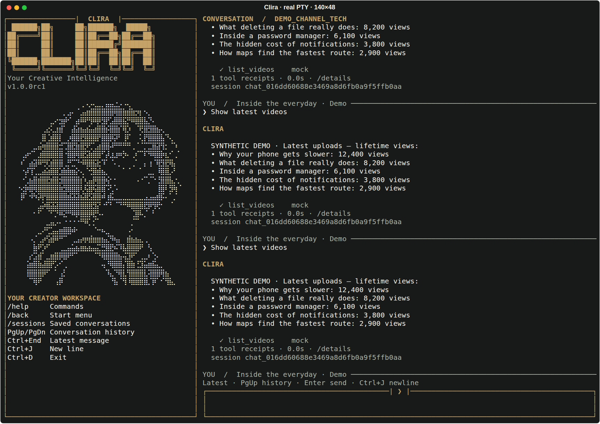

# Clira split terminal

The owner-requested layout keeps Clira visible throughout long conversations. The left sidebar
pins the large lettering, exact approved monochrome Braille portrait and command hints. The right
side contains independently scrollable output and a fixed multiline composer. The existing service,
commands, SQLite sessions and exact owner approvals remain in use.



[First-run view](media/terminal/welcome-split.png). These previews come from actual terminal processes:
pexpect drives the application, pyte decodes visible VT cells, and Rich exports those cells to SVG.
They use synthetic demo data and installed system fonts. They do not establish live-channel success.

## Palette and composition

The [supplied master specification](../CLIRA_V1_TERMINAL_WEB_MASTER_SPEC_AND_CODEX_PROMPT.md) supplies
Ink/Ivory, Antique Gold and the approved portrait. The owner's later requests control the large
lettering, borders and persistent split layout.

| Role | Light | Dark |
|---|---|---|
| Main text | Ink `#252B24` | Ivory `#F3F0E8` |
| Wordmark, borders, headings | Gold `#85652F` | Gold `#C5A368` |
| Secondary text | `#62675C` | `#ABB1A5` |
| Preview background | Ivory `#F8F7F2` | Ink `#171A18` |

Runtime inherits the terminal's background. Auto inherits the main foreground, using light gold
when COLORFGBG reports a conventional white background (7 or 15), dark gold otherwise. Explicit
`/theme light` and `/theme dark` resolve missing background hints. NO_COLOR and mono disable color
in both panes. The portrait is unchanged and monochrome. Light secondary text passes 4.5:1 on Ivory.

| Space | Layout |
|---|---|
| 110+ columns, 42+ rows | Large CLIRA, portrait and help in a fixed left sidebar |
| 110+ columns, 34–41 rows | Small CLIRA identity, full portrait and help |
| 110+ columns, 24–33 rows | Compact sidebar identity and help, no cropped portrait |
| Under 110 columns or 24 rows | Fixed compact header, conversation and composer |
| `--no-logo` | Text identity/help; no large lettering or portrait |

Both the transcript and input reflow on resize. Unsent input survives resizing. The ordinary
scrolling renderer remains available with `CLIRA_TERMINAL_LAYOUT=inline uv run --locked clira`;
TERM=dumb selects it automatically. Redirected use keeps the existing noninteractive guidance.

## Controls

- Enter sends; Ctrl+J or Alt+Enter adds a newline.
- Page Up/Page Down browse conversation output; Ctrl+End follows the latest message.
- Tab completes slash commands and known channel IDs; Ctrl+R searches input history.
- `/back` opens the start menu; `0` returns to the current workspace and conversation.
- During setup, `/back` revisits a question and `/cancel` returns to the menu without creating a draft.
- `/clear` clears displayed output while keeping the sidebar and stored conversations.
- Empty Ctrl+D exits; Ctrl+C clears idle input, and a second idle Ctrl+C exits.

A running request disables the composer while the display remains responsive to resize and history
navigation. Ctrl+C during work reports that it is still running; it never claims a write was
cancelled. Actual elapsed time and tool receipts remain visible. No fake streaming is introduced.
The existing workflow runs serially on one UI worker thread; no extra agent or durable job worker is
started. OAuth exact-channel confirmation also uses the composer. Owner review still exposes the
full exact payload; granting approval does not execute it.

## Verification

The full suite includes real-screen VT tests at 40/80/140 columns, long transcripts, an unchanged
sidebar, Page Up/Down, retained input across resizing, setup Back/Cancel, session persistence,
clear, multiline submission, completion, history search, palette switching, NO_COLOR and owner
approval without execution. Existing inline terminal, security, policy, API and shared-session
regressions remain part of the suite. Browser checks cover all eight views at five viewport widths.

```bash
uv run --locked --extra dev pytest -q
uv run --locked --extra dev ruff check clira tests scripts
uv run --locked --extra dev ruff format --check clira tests scripts
uv run --locked --extra dev python scripts/capture_split_terminal.py --output work/split-terminal/previews
uv run --locked --extra dev python tests/browser_smoke.py --output work/split-terminal/browser
```

Package checks require the split-screen runtime in the wheel. Clean wheel/source ZIP/sdist installs
verify both inline and default split terminal entrypoints. pyte is a development-only dependency;
the runtime uses the existing prompt_toolkit and Rich dependencies.

Exit the previous process with Ctrl+D and run `uv run --locked clira` to load the new layout.
