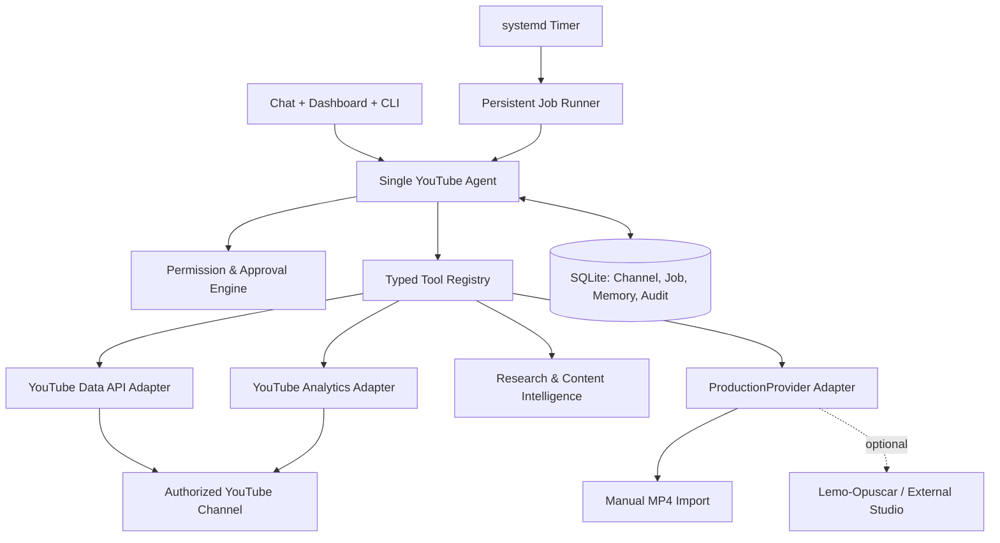

# 02 — System Architecture

## Boundary diagram

## Components
1. **Client**: localhost web UI + CLI; no secrets in browser localStorage.
2. **Agent runtime**: chosen model provider, tool-use cycle, schema validation and plan summary.
3. **Policy engine**: deterministic per-tool checks; LLM never grants its own permissions.
4. **Tool registry**: small, typed, documented methods and normalized error objects.
5. **Google adapters**: official APIs and scoped per-channel credentials.
6. **Content intelligence**: source-aware research and heuristics from the existing YouTube skill suite.
7. **Production provider**: `submit`, `status`, `collect`, `cancel` contract; supports no renderer.
8. **Job runner**: local durable queue with retry/idempotency and resource limits.
9. **SQLite**: authoritative local state with migrations, foreign keys, WAL where appropriate.
10. **Audit ledger**: each action's requester, channel, scope, approval, before/after, response and redacted errors.

## Main sequences
### Ask for recommendations
User request → resolve channel → read fresh channel analytics/video history → optional public niche research → propose 3 ideas with citations and constraints → persist drafts → show owner.

### Upload privately
User chooses channel + MP4 → validate path, codec, rights & metadata → show exact intended destination/visibility → approval → start/resume upload → store video ID and receipt → verify remote privacy = private → return result.

### Schedule a private video
Confirm owner, channel, video ID, future timezone-aware timestamp and un-published private state → approval → `videos.update` with correct `part` and preservation of needed fields → fetch and verify scheduled state.

### External production
Approved brief → provider adapter → output manifest with media paths/hash/licensing → ingest + QC → private upload queue. No provider? The user can import files manually.

## Trust boundaries
- **Model instructions and retrieved text are untrusted.** A YouTube comment or webpage must never change tool permissions.
- Only backend executes mutating tools after deterministic policy evaluation.
- OAuth tokens stored in an OS-protected location/keyring, never returned to model or frontend.
- Avoid raw shell execution from chat. Use allowlisted process commands and fixed argument validation.
- User-supplied paths must be restricted to a configured workspace or explicitly approved import.
- Per-channel secrets and rows have immutable channel IDs, not names as identifiers.

## Reliability patterns
- Outbox + idempotency keys for any upload or metadata write.
- One job lock per channel/resource; no overlapping writes.
- Provenance and timestamps on every analytics claim.
- Use page tokens for listing and API pagination; account for quotas.
- Optional renderer must not be coupled into agent decision-making.
